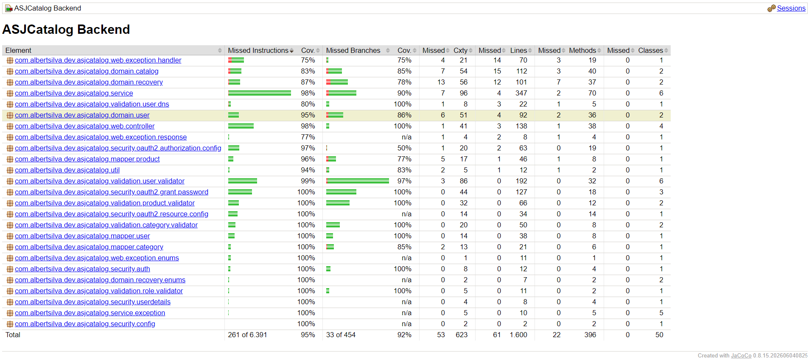
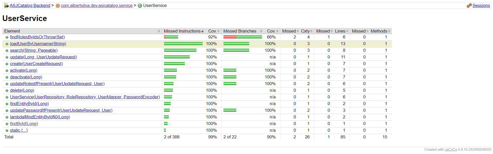
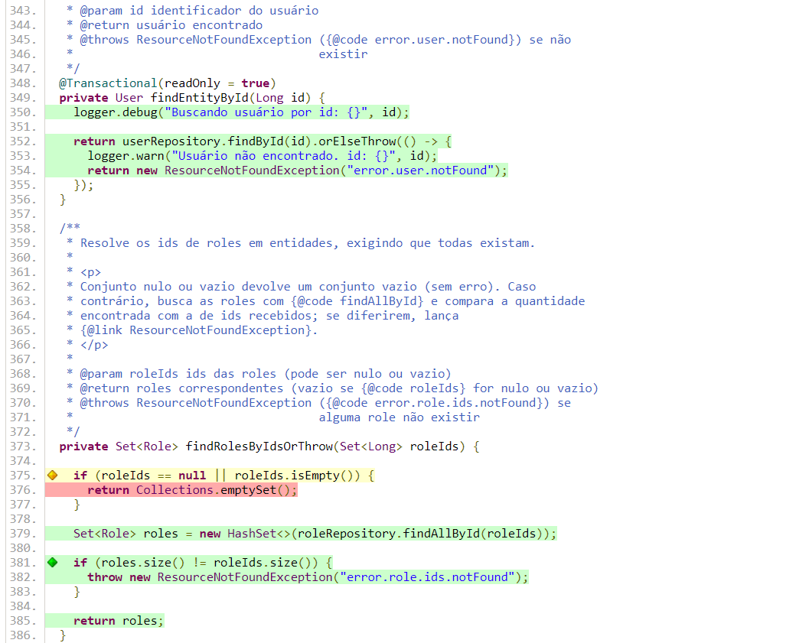

<h1 align="center">🧪 Capítulo 05 — Test Coverage with JaCoCo & Test Quality</h1>

<p align="justify">
<em>
This chapter measures what the automated tests actually execute, turns code coverage into a build gate, and raises the quality of the whole test suite: unit, web and integration tests rewritten to a single standard, scenarios tied to open issues made explicit, and a test suite that no longer depends on the network.
</em>
</p>

<p align="center">


<a href="LICENSE"></a>


</p>

<p align="justify">
<em>
Neste capítulo, o projeto <strong>ASJCatalog</strong> passa a medir o que os testes realmente executam. O <strong>JaCoCo</strong> gera relatórios de cobertura dos testes de unidade, dos testes de integração e dos dois juntos, e o build passa a falhar se a cobertura cair abaixo de um limite. Ao mesmo tempo, toda a suíte foi revisada para um padrão único de qualidade, os cenários ligados a issues abertas ficaram registrados nos próprios testes e os testes deixaram de depender da internet.

O nome <strong>ASJCatalog</strong> vem das iniciais de <strong>Albert Silva de Jesus</strong>: o projeto nasceu da base do <strong>DSCatalog</strong>, do curso DevSuperior, e evoluiu de forma independente.
</em>

</p>

<p align="center">
<a href="docs/HOME.md"><strong>📖 Documentação técnica</strong></a> · <a href="docs/guides/GETTING-STARTED.md">🚀 Primeiros Passos</a> · <a href="docs/guides/TESTING.md#9-cobertura-com-jacoco">🧪 Testes e Cobertura</a> · <a href="docs/guides/DESIGN-DECISIONS.md">🧭 Decisões Técnicas</a> · <a href="https://asjcatalog-jacoco.netlify.app/">📊 Relatório JaCoCo</a>
</p>

---

## 📑 Sumário

> Navegação do capítulo.

---

| 🧩 Module                                                                       | ⚡ Description                                                 |
| ------------------------------------------------------------------------------- | -------------------------------------------------------------- |
| [📚 Contexto da Implementação](#-contexto-da-implementação)                     | Ponto de partida e motivação do capítulo                       |
| [🎯 Objetivos](#-objetivos)                                                     | Metas técnicas do capítulo                                     |
| [🏆 Resultados](#-resultados)                                                   | Relatório geral, evolução antes × depois e relatório publicado |
| [🚀 Como Executar](#-como-executar)                                             | Rodar os testes e abrir o relatório de cobertura               |
| [🔬 Abordagens de Teste](#-abordagens-de-teste)                                 | Caixa branca, caixa preta e o caso intermediário               |
| [🎭 Mockito na Prática](#-mockito-na-prática)                                   | `@Mock`, `@InjectMocks` e `spy` com exemplos do projeto        |
| [📐 Tipos de Cobertura](#-tipos-de-cobertura)                                   | Linhas, branches, métodos e complexidade ciclomática           |
| [📊 Como Ler o Relatório](#-como-ler-o-relatório)                               | Colunas, cores e diamantes, com os prints do `UserService`     |
| [🔧 Configuração do JaCoCo no pom.xml](#-configuração-do-jacoco-no-pomxml)      | Cada execução do plugin, exclusões e limites                   |
| [🔀 Unidade, Integração e Consolidado](#-unidade-integração-e-consolidado)      | Por que o relatório consolidado é o principal                  |
| [🎯 100% Não É Meta](#-100-não-é-meta)                                          | Exclusões, cenários pendentes e código sem uso                 |
| [✅ Padrão de Qualidade dos Testes](#-padrão-de-qualidade-dos-testes)           | As regras que toda a suíte passou a seguir                     |
| [🌐 Testes sem Dependência de Rede](#-testes-sem-dependência-de-rede)           | A consulta de MX fora dos testes (#20)                         |
| [💡 Lições do Capítulo](#-lições-do-capítulo)                                   | Cobertura alta sem cenário completo e cobertura acidental      |
| [🧩 Fora do Plano](#-fora-do-plano)                                             | Pipeline de CI e a primeira contribuição externa               |
| [🎓 Aprendizados](#-aprendizados)                                               | Conhecimentos consolidados ao longo do capítulo                |
| [💼 Competências Técnicas Desenvolvidas](#-competências-técnicas-desenvolvidas) | Competências praticadas na implementação                       |
| [🏁 Conclusão](#-conclusão)                                                     | Considerações finais                                           |
| [📖 Documentação Técnica](#-documentação-técnica)                               | Onde encontrar os guias técnicos do backend                    |
| [📚 Referências Técnicas](#-referências-técnicas)                               | Documentações oficiais e materiais utilizados                  |
| [👨‍💻 Autor](#-autor)                                                             | Informações sobre o autor da documentação                      |
| [📎 Contato](#-contato)                                                         | Canais de contato e redes profissionais                        |

---

## 📚 Contexto da Implementação

No fim do capítulo 04, o ASJCatalog tinha 301 testes de unidade e 150 testes de integração, e todos passavam. Faltava responder a uma pergunta simples: **quanto do código esses testes executam, e o que fica de fora?**

Também havia problemas que só uma revisão da suíte mostraria: testes com nomes que não diziam o método testado, asserções que só conferiam se um valor existia, dados escritos à mão em cada teste e 19 testes que falhavam sem internet, porque a validação de e-mail consultava o DNS de verdade.

---

## 🎯 Objetivos

- Medir a cobertura dos testes de unidade, dos testes de integração e dos dois juntos com o JaCoCo.
- Fazer o build falhar quando a cobertura cair abaixo de um limite mínimo.
- Revisar toda a suíte para um padrão único de qualidade, documentado no guia de testes.
- Registrar nos próprios testes os cenários que dependem de issues abertas, sem congelar comportamento errado.
- Remover a dependência de rede dos testes, pré-requisito para rodá-los num pipeline de CI.

---

## 🏆 Resultados

O relatório consolidado do fim do capítulo, com todos os pacotes do projeto e a linha **Total**:

<p align="center">

</p>

**Evolução do capítulo.** A coluna "Início" foi medida no commit `b1cb5cf`, o primeiro com o JaCoCo; a coluna "Fim", no commit `48ba709`.

| Métrica                                  | Início (`b1cb5cf`)                   | Fim (`48ba709`)                   |
| ---------------------------------------- | ------------------------------------ | --------------------------------- |
| Testes de unidade                        | 301                                  | 453                               |
| Testes de integração                     | 150                                  | 150                               |
| Linhas, relatório consolidado            | 88,7% (1411 de 1591)                 | 96,2% (1539 de 1600)              |
| Branches, relatório consolidado          | 71,1% (323 de 454)                   | 92,7% (421 de 454)                |
| Linhas, relatório de unidade             | 79,0%                                | 95,6%                             |
| Branches, relatório de unidade           | 64,1%                                | 92,3%                             |
| Linhas dos mappers, relatório de unidade | de 2% a 5%                           | de 97,8% a 100%                   |
| Limite mínimo do build                   | nenhum                               | 0,93 de linhas e 0,89 de branches |
| Testes que falham sem internet           | 19 (8 de unidade e 11 de integração) | 0                                 |

Os testes de integração continuam 150, mas foram todos revisados para o padrão de qualidade. O total de linhas passou de 1591 para 1600 porque a consulta de DNS ganhou uma classe própria (veja [Testes sem Dependência de Rede](#-testes-sem-dependência-de-rede)).

> [!TIP]
> O relatório completo, navegável até o código colorido de cada classe, está publicado em **[asjcatalog-jacoco.netlify.app](https://asjcatalog-jacoco.netlify.app/)**. É o relatório **consolidado**, gerado a partir do commit `48ba709`, e é um retrato fixo: ele não é atualizado a cada push. A publicação automática do relatório a cada build é um tema para o capítulo de Docker e CI/CD.

---

## 🚀 Como Executar

**Pré-requisito:** JDK 17. Os testes usam o banco H2 em memória e não precisam de PostgreSQL, de servidor de e-mail nem de internet.

**PowerShell**:

```powershell
git clone https://github.com/Albertinesilva/backend-engineering-journey-java-springboot.git
cd backend-engineering-journey-java-springboot; git checkout chapter-05-jacoco
cd backend
.\mvnw clean verify
Start-Process .\target\site\jacoco-merged\index.html
```

**bash**:

```bash
git clone https://github.com/Albertinesilva/backend-engineering-journey-java-springboot.git
cd backend-engineering-journey-java-springboot && git checkout chapter-05-jacoco
cd backend
./mvnw clean verify
xdg-open target/site/jacoco-merged/index.html
```

O `clean verify` apaga os resultados anteriores, roda os testes de unidade e de integração, gera os três relatórios em `backend/target/site/` e confere o limite mínimo de cobertura. No macOS, troque `xdg-open` por `open`.

> [!TIP]
> Para subir a aplicação (perfil `dev`, com PostgreSQL), siga [Primeiros Passos](docs/guides/GETTING-STARTED.md). Todos os comandos de teste, inclusive para rodar uma única classe, estão em [Testes](docs/guides/TESTING.md#3-comandos).

---

## 🔬 Abordagens de Teste

Um teste pode olhar para o código de duas formas, e o ASJCatalog usa as duas.

**Caixa branca** é o teste que conhece o código por dentro: sabe quais colaboradores a classe usa e confere como ela os chama. São os testes de unidade, como o `UserServiceTest`. Ele troca o repositório por um objeto falso e confere que o método saiu cedo, sem repetir a ativação:

```java
// UserServiceTest: o teste sabe que activate() não deve ser chamado de novo
service.activate(EXISTING_ID);

assertThat(user.isActive()).isTrue();
verify(user, never()).activate();
```

**Caixa preta** é o teste que só conhece a entrada e a saída: faz uma requisição HTTP e confere a resposta, sem saber que classes existem por trás dela. O `AccountFlowIT` testa assim os fluxos de conta: cadastra, ativa e faz login por HTTP, como faria um cliente da API. O `ResourceServerAuthorizationIT` é um exemplo puro:

```java
// ResourceServerAuthorizationIT: só a requisição e a resposta
ResultActions result = mockMvc.perform(get(USERS_URL)
    .with(bearerToken(operatorToken))
    .accept(MediaType.APPLICATION_JSON));

result
    .andExpect(status().isForbidden())
    .andExpect(jsonPath("$.code").value("ACCESS_DENIED"));
```

**O caso intermediário.** Muitos testes de integração chamam a API por HTTP e, depois, consultam o banco para conferir o que foi gravado. A requisição é de caixa preta, mas a conferência conhece a estrutura interna (o repositório e a entidade). No `CategoryControllerIT`, o `POST` é conferido pela resposta e também pelo registro salvo:

```java
// CategoryControllerIT: depois da requisição, confere o banco
assertThat(categoryRepository.count()).isEqualTo(initialCount + 1);
assertThat(categoryRepository.findById(id).orElseThrow())
    .extracting(Category::getName, Category::getDescription)
    .containsExactly(request.name(), request.description());
```

O próprio `AccountFlowIT` faz isso num ponto: o e-mail de ativação é simulado, então o teste lê o token de ativação no `TokenRepository` em vez de abri-lo numa caixa de entrada.

---

## 🎭 Mockito na Prática

O **Mockito** cria objetos falsos para isolar a classe testada dos seus colaboradores. No `UserServiceTest`:

```java
@ExtendWith(MockitoExtension.class)
class UserServiceTest {

  @InjectMocks
  private UserService service;

  @Mock
  private UserRepository repository;

  @Mock
  private RoleRepository roleRepository;

  @Mock
  private UserMapper userMapper;

  @Mock
  private PasswordEncoder passwordEncoder;
```

- **`@Mock`** cria um objeto falso: todos os métodos existem, mas não fazem nada e devolvem valores vazios (`null`, `0`, `false`), até que o teste programe uma resposta com `when(...).thenReturn(...)`. Aqui, o `UserRepository` falso devolve o usuário que o teste quiser, sem banco.
- **`@InjectMocks`** cria a classe testada de verdade (`UserService`) e entrega a ela os mocks pelo construtor. O código do service roda inteiro; só os colaboradores são falsos.
- **Spy** é um objeto **real** "espionado": os métodos funcionam de verdade, mas cada chamada fica registrada para ser conferida com `verify`. O Mockito oferece a anotação `@Spy` e o método `spy(objeto)`; o projeto usa o método, porque o objeto espionado é criado em cada teste, com um estado próprio.

**Por que um spy nos testes de "status já definido".** O `UserService.activate` só ativa o usuário se ele estiver inativo. No teste do usuário que **já está ativo**, o estado final é o mesmo nos dois caminhos possíveis (ativo), então conferir `isActive()` não prova nada. O spy permite provar que o método saiu cedo, sem chamar `activate()` na entidade:

```java
// UserServiceTest.activateShouldNotChangeUserWhenUserIsAlreadyActive
// O spy é necessário porque o estado final (ativo) é o mesmo nos dois
// caminhos; só o verify prova que o método saiu cedo.
User user = spy(UserFactory.createUser());
user.setId(EXISTING_ID);

when(repository.findById(EXISTING_ID)).thenReturn(Optional.of(user));

service.activate(EXISTING_ID);

assertThat(user.isActive()).isTrue();
verify(user, never()).activate();
```

O mesmo recurso aparece nos testes de `activate` e `deactivate` do `CategoryServiceTest` e do `ProductServiceTest`.

---

## 📐 Tipos de Cobertura

O JaCoCo conta a cobertura de várias formas. Os exemplos abaixo são do relatório consolidado do fim do capítulo.

**Cobertura de linhas (*line coverage*).** Uma linha conta como coberta quando ao menos uma instrução dela foi executada. No `UserService.findRolesByIdsOrThrow`, 5 das 6 linhas com código foram executadas; a que falta é o `return Collections.emptySet()`.

**Cobertura de branches (*branch coverage*).** Um *branch* é cada caminho possível de uma decisão. Neste método há seis:

```java
private Set<Role> findRolesByIdsOrThrow(Set<Long> roleIds) {

  if (roleIds == null || roleIds.isEmpty()) {   // 4 branches: cada condição verdadeira ou falsa
    return Collections.emptySet();
  }

  Set<Role> roles = new HashSet<>(roleRepository.findAllById(roleIds));

  if (roles.size() != roleIds.size()) {          // 2 branches
    throw new ResourceNotFoundException("error.role.ids.notFound");
  }

  return roles;
}
```

Os testes passam por 4 dos 6 (66%): nunca enviam `roleIds` nulo nem vazio. A linha do primeiro `if` foi executada, mas a decisão não foi testada por completo. É por isso que a cobertura de linhas sozinha engana.

**Cobertura de métodos (*method coverage*).** Um método conta como coberto quando ao menos uma instrução dele foi executada. O `Token.isValid()` aparece com 0%: nenhum código do projeto o chama, e ele está registrado como código sem uso na #25.

```java
public boolean isValid() {
  return !disabled && !isExpired();
}
```

**Complexidade ciclomática (coluna Cxty).** É o número mínimo de caminhos diferentes por um método: 1 para um método sem decisões, mais 1 para cada decisão. O `findRolesByIdsOrThrow` tem três decisões (`roleIds == null`, `roleIds.isEmpty()` e `roles.size() != roleIds.size()`), então seu Cxty é **4**. O relatório mostra **2** desses 4 caminhos sem teste. O `Token.isValid()` tem duas decisões (`!disabled` e `!isExpired()`) e Cxty 3. Quanto maior o Cxty, mais testes o método precisa para ter todos os caminhos conferidos.

---

## 📊 Como Ler o Relatório

**As colunas.** Para cada pacote, classe ou método, o relatório mostra o que **não** foi coberto (colunas "Missed") e a porcentagem coberta (colunas "Cov."):

| Coluna       | O que conta                                                                                              | Total do projeto                 |
| ------------ | -------------------------------------------------------------------------------------------------------- | -------------------------------- |
| Instructions | Instruções de **bytecode**, o código que o compilador Java gera a partir do `.java`. É a medida mais fina | 261 de 6.391 sem cobertura (95%) |
| Branches     | Caminhos de cada decisão (`if`, `&&`, `\|\|`, `switch`)                                                    | 33 de 454 sem cobertura (92%)    |
| Cxty         | Complexidade ciclomática                                                                                 | 53 de 623 sem cobertura          |
| Lines        | Linhas do `.java` com ao menos uma instrução                                                             | 61 de 1.600 sem cobertura (96%)  |
| Methods      | Métodos com ao menos uma instrução                                                                       | 22 de 396 sem cobertura          |
| Classes      | Classes com ao menos uma instrução                                                                       | 0 de 50 sem cobertura            |

As porcentagens diferem porque cada coluna conta uma unidade diferente. Uma linha como `if (roleIds == null || roleIds.isEmpty())` tem várias instruções e quatro branches: basta uma instrução rodar para a linha contar como coberta, mas cada branch é contado separadamente.

**A tabela de métodos.** Ao abrir a classe `UserService`, cada método aparece numa linha. O `findRolesByIdsOrThrow` é o único abaixo de 100%: 92% das instruções, 66% dos branches, 2 de 4 caminhos de complexidade e 1 de 6 linhas sem cobertura.

<p align="center">

</p>

**O código colorido.** Ao abrir o código da classe, cada linha ganha uma cor, e cada decisão ganha um diamante:

| Marca             | Significado                                                                        |
| ----------------- | ---------------------------------------------------------------------------------- |
| Linha verde       | Todas as instruções da linha foram executadas                                      |
| Linha amarela     | Só parte das instruções ou dos branches foi executada                              |
| Linha vermelha    | Nenhuma instrução da linha foi executada                                           |
| Diamante verde    | Todos os branches da decisão foram executados                                      |
| Diamante amarelo  | Parte dos branches foi executada (passe o mouse sobre ele para ver quantos faltam) |
| Diamante vermelho | Nenhum branch da decisão foi executado                                             |

<p align="center">

</p>

No print, as linhas 343 a 386 do `UserService`:

- **linha 375, amarela, com diamante amarelo:** o `if (roleIds == null || roleIds.isEmpty())` foi executado, mas só com `roleIds` preenchido. Os branches de `roleIds` nulo e vazio nunca rodaram;
- **linha 376, vermelha:** o `return Collections.emptySet()` nunca foi executado, porque nenhum teste chega nesse caminho;
- **linha 381, com diamante verde:** o `if (roles.size() != roleIds.size())` foi testado nos dois sentidos, com todas as roles encontradas e com uma role inexistente.

**Por que esse trecho ficou sem teste.** É o caminho de um usuário criado sem roles. Hoje, `POST /api/v1/users` sem `roleIds` cria o usuário sem nenhuma role, e ele não consegue fazer login: é o defeito da **#14**. Um teste desse caminho teria de confirmar o comportamento atual, que está errado, ou depender da correção que ainda não foi feita. Por isso o cenário fica sem teste, registrado na issue, até a correção.

---

## 🔧 Configuração do JaCoCo no pom.xml

**Por que é um plugin, e não uma dependência.** Uma dependência é uma biblioteca que o código do projeto importa e usa, e por isso entra no *classpath* (o conjunto de classes que a aplicação carrega). O código do ASJCatalog não importa nenhuma classe do JaCoCo: ele só é necessário **durante o build**, enquanto os testes rodam. O JaCoCo funciona como um **agente Java**: um programa que a JVM carrega junto com os testes e que instrumenta (modifica em memória) as classes do projeto, para registrar cada instrução executada. Por isso ele fica em `<build><plugins>`, e não em `<dependencies>`, e não vai para o pacote final da aplicação.

```xml
<plugin>
  <groupId>org.jacoco</groupId>
  <artifactId>jacoco-maven-plugin</artifactId>
  <version>0.8.15</version>
```

A versão é declarada no próprio `pom.xml`, porque o `spring-boot-starter-parent` não gerencia a versão do JaCoCo.

**Execuções, na ordem em que rodam no `./mvnw verify`.** Cada `<execution>` liga um *goal* (uma tarefa) do plugin a uma fase do ciclo de vida do Maven:

| Execução                    | Goal                        | Fase                            | O que faz                                                                                              |
| --------------------------- | --------------------------- | ------------------------------- | ------------------------------------------------------------------------------------------------------ |
| `prepare-agent`             | `prepare-agent`             | `initialize` (padrão)           | Prepara o agente para os testes de unidade (Surefire). O resultado vai para `target/jacoco.exec`       |
| `report`                    | `report`                    | `test`                          | Gera o relatório de unidade em `target/site/jacoco`                                                    |
| `prepare-agent-integration` | `prepare-agent-integration` | `pre-integration-test` (padrão) | Prepara o agente para os testes de integração (Failsafe). O resultado vai para `target/jacoco-it.exec` |
| `report-integration`        | `report-integration`        | `post-integration-test`         | Gera o relatório de integração em `target/site/jacoco-it`                                              |
| `merge`                     | `merge`                     | `verify`                        | Junta `jacoco.exec` e `jacoco-it.exec` em `target/jacoco-merged.exec`                                  |
| `report-merged`             | `report`                    | `verify`                        | Gera o relatório consolidado em `target/site/jacoco-merged`                                            |
| `check-merged`              | `check`                     | `verify`                        | Confere os limites mínimos sobre o consolidado e falha o build se ficarem abaixo                       |

O `prepare-agent` não roda os testes: ele monta o argumento `-javaagent` e o coloca na propriedade `argLine`, que o Surefire usa ao iniciar a JVM dos testes. Os nomes das sessões são fixos, para que o nome da máquina não apareça na página "Sessions" de um relatório publicado:

```xml
<execution>
  <id>prepare-agent</id>
  <goals>
    <goal>prepare-agent</goal>
  </goals>
  <!-- Nome fixo da sessão: o padrão usa o nome da máquina, que apareceria na página Sessions dos relatórios -->
  <configuration>
    <sessionId>asjcatalog-unit</sessionId>
  </configuration>
</execution>
```

A junção dos dois arquivos de execução é o que permite o relatório consolidado:

```xml
<execution>
  <id>merge</id>
  <phase>verify</phase>
  <goals>
    <goal>merge</goal>
  </goals>
  <configuration>
    <fileSets>
      <fileSet>
        <directory>${project.build.directory}</directory>
        <includes>
          <include>jacoco.exec</include>
          <include>jacoco-it.exec</include>
        </includes>
      </fileSet>
    </fileSets>
    <destFile>${project.build.directory}/jacoco-merged.exec</destFile>
  </configuration>
</execution>
```

**Exclusões.** Classes sem lógica ficam fora do cálculo, para que a porcentagem reflita só o código que pode ter defeito:

```xml
<excludes>
  <!-- Classe principal: só o main com SpringApplication.run -->
  <exclude>com/albertsilva/dev/asjcatalog/AsjcatalogApplication.class</exclude>
  <!-- DTOs: records sem lógica -->
  <exclude>com/albertsilva/dev/asjcatalog/dto/**</exclude>
  <!-- Projections: interfaces sem métodos default -->
  <exclude>com/albertsilva/dev/asjcatalog/projection/**</exclude>
  <!-- Configurações que só criam beans, sem desvios -->
  <exclude>com/albertsilva/dev/asjcatalog/config/documentation/**</exclude>
  <exclude>com/albertsilva/dev/asjcatalog/config/i18n/**</exclude>
  <!-- Respostas de erro sem lógica (ValidationError fica, por causa do addError) -->
  <exclude>com/albertsilva/dev/asjcatalog/web/exception/response/ProblemDetails.class</exclude>
  <exclude>com/albertsilva/dev/asjcatalog/web/exception/response/FieldMessage.class</exclude>
</excludes>
```

As interfaces dos repositórios também não aparecem no relatório, sem precisar de exclusão: o código delas é gerado pelo Spring Data enquanto a aplicação roda, e o JaCoCo só mede as classes compiladas do projeto.

**Limites mínimos.** O `check-merged` avalia o elemento `BUNDLE`, que é o projeto inteiro:

```xml
<rule>
  <element>BUNDLE</element>
  <limits>
    <limit>
      <counter>LINE</counter>
      <value>COVEREDRATIO</value>
      <minimum>${jacoco.minimum.line.coverage}</minimum>
    </limit>
    <limit>
      <counter>BRANCH</counter>
      <value>COVEREDRATIO</value>
      <minimum>${jacoco.minimum.branch.coverage}</minimum>
    </limit>
  </limits>
</rule>
```

Os valores ficam em propriedades, no início do `pom.xml`:

```xml
<!-- Limites mínimos de cobertura do goal check do JaCoCo (relatório consolidado) -->
<jacoco.minimum.line.coverage>0.93</jacoco.minimum.line.coverage>
<jacoco.minimum.branch.coverage>0.89</jacoco.minimum.branch.coverage>
```

Cada limite é o valor medido no fim do capítulo menos **3 pontos de folga**, arredondado para baixo: 0,9619 de linhas vira 0,93, e 0,9273 de branches vira 0,89. A folga deixa espaço para código novo ainda sem teste completo, sem permitir uma queda grande. O limite é do projeto inteiro, e não de cada pacote, porque vários pacotes têm de 2 a 20 linhas, e um limite por pacote faria o build falhar com a mudança de um único teste.

Como as propriedades podem ser trocadas na linha de comando com `-D`, dá para conferir que o `check` funciona sem alterar o `pom.xml`. Com um limite acima do medido, o build falha:

**PowerShell** (argumentos `-D` com ponto no nome vão entre aspas simples):

```powershell
.\mvnw verify '-Djacoco.minimum.line.coverage=0.97'
```

**bash**:

```bash
./mvnw verify -Djacoco.minimum.line.coverage=0.97
```

```text
[WARNING] Rule violated for bundle asjcatalog: lines covered ratio is 0.96, but expected minimum is 0.97
[INFO] BUILD FAILURE
```

---

## 🔀 Unidade, Integração e Consolidado

O build gera três relatórios porque os testes de unidade e os de integração cobrem partes diferentes do código:

| Relatório       | Pasta                       | Linhas    | Branches  |
| --------------- | --------------------------- | --------- | --------- |
| Unidade         | `target/site/jacoco`        | 95,6%     | 92,3%     |
| Integração      | `target/site/jacoco-it`     | 76,3%     | 43,6%     |
| **Consolidado** | `target/site/jacoco-merged` | **96,2%** | **92,7%** |

Os testes de integração sobem a aplicação inteira e passam por muitas linhas, mas por poucos branches: em geral, seguem o caminho de sucesso e alguns erros. Os testes de unidade isolam cada classe e conseguem forçar cada desvio.

**Por que o consolidado é o principal.** No início do capítulo, os mappers (`CategoryMapper`, `ProductMapper` e `UserMapper`) apareciam com **2% a 5%** de linhas no relatório de unidade, porque os testes dos services usam mappers falsos (`@Mock`). No consolidado, os mesmos mappers tinham **81% a 90%**, porque os testes de integração os executavam de verdade. Olhar só o relatório de unidade levaria a escrever testes para algo que já estava coberto; olhar só o de integração esconderia os desvios testados na unidade. Por isso o limite do build é avaliado sobre o consolidado. Ao longo do capítulo, os mappers ganharam testes de unidade próprios e passaram a ter de 97,8% a 100% de linhas também no relatório de unidade.

---

## 🎯 100% Não É Meta

As 61 linhas e os 33 branches sem cobertura no fim do capítulo não são esquecimento. Perseguir 100% levaria a testes que só executam código, sem conferir nada, ou a testes que congelam comportamentos que o projeto quer mudar.

**Exclusões.** Classes sem lógica ficam fora do cálculo (seção [Configuração do JaCoCo](#-configuração-do-jacoco-no-pomxml)).

**Cenários pendentes ligados às issues.** Quando o comportamento certo depende de uma issue aberta, o cenário fica sem teste e é registrado no JavaDoc da classe de teste, numa seção "Cenários pendentes", com o número da issue. Um exemplo, no `ProductServiceTest`:

```java
/**
 * <b>Cenários pendentes:</b>
 * <ul>
 * <li>{@code categoryIds} nulo ou vazio: o produto seria criado sem categoria
 * e não apareceria na listagem; hoje o {@code @NotEmpty} do DTO bloqueia o
 * caso na API (#4).</li>
 * </ul>
 */
```

Os trechos sem teste por esse motivo estão ligados às issues #4, #5, #9, #13, #14, #25, #28, #36, #39 e #44.

**Código sem uso.** A revisão encontrou código que nenhuma parte do projeto chama: `Token.isValid()`, `ProductMapper.toResponsePage`, os construtores com id de `Product` e `Category` e `Category.getProducts()`. Escrever testes para eles daria cobertura a algo que talvez deva ser removido. Eles foram registrados num [comentário da #25](https://github.com/Albertinesilva/backend-engineering-journey-java-springboot/issues/25#issuecomment-6614166933), que vai decidir se cada um sai ou fica documentado. Dois ramos da deduplicação de erros de senha também são inalcançáveis e estão no [item 11 da #25](https://github.com/Albertinesilva/backend-engineering-journey-java-springboot/issues/25#issuecomment-6620385478).

**Não congelar comportamento errado.** Se uma asserção afirmava um valor que uma issue diz estar errado, ela foi removida, e o cenário foi para "Cenários pendentes". Assim:

- o `EmailServiceTest` deixou de conferir o link de recuperação de senha com o caminho atual (#46) e o status gravado do registro de e-mail (#26);
- o `UserUpdateValidatorTest` perdeu o teste que esperava um `NullPointerException`, que congelava um defeito em vez de uma regra.

Um teste que defende o comportamento errado faria a correção da issue parecer uma regressão.

---

## ✅ Padrão de Qualidade dos Testes

Toda a suíte foi revisada, classe por classe, para um padrão único, documentado com exemplos de "evitar" e "preferir" na [seção 7 do guia de testes](docs/guides/TESTING.md#7-padrão-de-qualidade-dos-testes). Em resumo:

- **Nomes:** `<método>Should<resultado>When<condição>`, com um `@DisplayName` em inglês que diz o mesmo, como `findByIdShouldReturnCategoryWhenIdExists`.
- **Estrutura:** um `@Nested` por método ou endpoint (nos testes HTTP, `"<VERBO> <rota>"`, como `GET /categories/{id}`), um comportamento por teste e os blocos Arrange, Act e Assert.
- **Asserções:** AssertJ (`assertThat`) nos testes novos e retrabalhados, sem misturar estilos na mesma classe; o valor esperado conferido por inteiro; exceções conferidas pelo tipo e pela chave da mensagem.
- **Dados:** das fábricas do pacote `factory` e das suas constantes, sem valores escritos à mão. As constantes que vêm do seed, como `UserFactory.ADMIN_USER_ID`, citam a #21 no JavaDoc.
- **Mocks:** só para colaboradores; `spy` só quando o resultado é o mesmo nos dois caminhos.
- **Testes parametrizados:** `@ParameterizedTest` quando o comportamento é o mesmo para vários valores. O `EntityIdentityContractTest` confere o contrato de `equals` e `hashCode` das seis entidades num único teste, com 42 casos.
- **Issues abertas:** sem congelar comportamento errado, com os cenários pendentes registrados no JavaDoc (seção [100% Não É Meta](#-100-não-é-meta)).

A seção termina com um checklist de revisão, usado também nos Pull Requests.

---

## 🌐 Testes sem Dependência de Rede

O `@ValidEmail` confere se o domínio do e-mail tem um registro **MX** (o registro de DNS que indica o servidor de e-mail do domínio). Antes do capítulo, a consulta ficava dentro do `ValidEmailValidator` e ia direto para a internet. Sem rede, **19 testes falhavam** (8 de unidade e 11 de integração), e a suíte não podia rodar de forma confiável num pipeline de CI (#20).

A consulta passou para uma interface própria, no pacote `validation.user.dns`:

```java
public interface MxRecordLookup {

  boolean hasMxRecord(String domain);
}
```

Em produção, quem a implementa é o `JndiMxRecordLookup`, que faz a mesma consulta de antes. Nos testes, o `MxRecordLookupTestConfig` registra uma implementação que considera que todo domínio tem MX:

```java
@TestConfiguration
public class MxRecordLookupTestConfig {

  @Bean
  @Primary
  MxRecordLookup mxRecordLookup() {
    return domain -> true;
  }
}
```

O formato do e-mail continua validado pela expressão regular real; só a consulta de MX é substituída. O comportamento em produção não mudou.

Para conferir, a suíte roda com o DNS simulado fora do ar, apontando o JNDI para uma porta do próprio computador em que nada responde. Antes da mudança, 19 testes falhavam assim; hoje, nenhum:

```powershell
.\mvnw clean verify '-Djava.naming.provider.url=dns://127.0.0.1:9'
```

A consulta real não ficou sem teste. O `JndiMxRecordLookupTest` a testa com um contexto de DNS falso, e o `JndiMxRecordLookupDnsTest` consulta o DNS de verdade (`gmail.com` tem MX; `asjcatalog.invalid` não existe). Ele tem a tag `dns`, que fica fora do build padrão, e roda só quando pedido:

```powershell
.\mvnw test '-Dtest=JndiMxRecordLookupDnsTest' '-Dsurefire.excludedGroups=none'
```

---

## 💡 Lições do Capítulo

**Cobertura alta não garante cenários completos.** Com **88,7%** de linhas cobertas no relatório consolidado, a API aceitava um produto **sem preço**: `POST /api/v1/products` com `"price": null`, sem o campo ou com `"price": ""` respondia 201 e gravava o produto (#44). O código do cadastro estava coberto, mas nenhum teste enviava o preço nulo. A cobertura mostra o que **não** foi executado; o que foi executado ainda pode estar sem o cenário certo. A correção está registrada na #44, com impacto no frontend.

**Cobertura acidental.** No `TokenServiceTest`, um teste conferia o token devolvido com `isEqualTo(token)`. O AssertJ chama o `equals` para comparar, e com isso o ramo `this == obj` do `Token.equals` aparecia como coberto, sem que nenhum teste tratasse do `equals`. Ao trocar a asserção por `isSameAs(token)` (que confere se é o mesmo objeto, que era o que o teste queria dizer), o ramo deixou de ser coberto. O contrato de `equals` e `hashCode` passou a ser testado de propósito, no `EntityIdentityContractTest`. Uma linha verde no relatório só diz que o código rodou, e não que ele foi conferido.

---

## 🧩 Fora do Plano

**Pipeline de CI.** O repositório ganhou um workflow do GitHub Actions (`.github/workflows/ci.yml`, commits `cedeba7` e `dd40232`). Em todo push e Pull Request para a branch `develop`, ele roda `./mvnw -B verify` com o JDK 17 (Temurin) no `ubuntu-24.04`. Como o `check` do JaCoCo roda na fase `verify`, um Pull Request que derrube a cobertura abaixo do limite falha no CI. Esse é também o motivo da #20: sem tirar o DNS dos testes, o CI dependeria da rede do runner.

**A primeira contribuição externa.** O Pull Request **#42**, de um contribuidor externo, padronizou a capitalização e a pontuação das mensagens da API nos três idiomas (commit `f35bfe5`). Foi a primeira contribuição de fora do projeto.

---

## 🎓 Aprendizados

- Cobertura mede o que foi executado, e não o que foi conferido.
- Relatórios de unidade e de integração contam histórias diferentes; o consolidado mostra a cobertura real.
- Branches dizem mais que linhas: uma linha coberta pode esconder uma decisão testada pela metade.
- Um limite mínimo no build transforma a cobertura em regra, e a folga evita que ele vire um obstáculo.
- Nem todo trecho sem cobertura é um problema: exclusões, código sem uso e cenários ligados a issues abertas são decisões.
- Um teste que confirma um comportamento errado é pior que a falta de teste.
- Testes que dependem de rede são um risco para qualquer pipeline.

---

## 💼 Competências Técnicas Desenvolvidas

- Configuração do `jacoco-maven-plugin` com relatórios de unidade, de integração e consolidado.
- Leitura de relatórios de cobertura: instruções, branches, linhas, métodos e complexidade ciclomática.
- Definição de limites mínimos de cobertura no build.
- Testes de unidade com JUnit 5, Mockito e AssertJ.
- Testes de integração com MockMvc, banco H2 e tokens JWT reais.
- Testes parametrizados com `@ParameterizedTest`.
- Isolamento de dependências externas (DNS) com interfaces e configurações de teste.
- Revisão sistemática de uma suíte de testes, com padrão documentado e checklist.
- Integração contínua com GitHub Actions.

---

## 🏁 Conclusão

Este capítulo trocou a pergunta "os testes passam?" por "o que os testes realmente conferem?". O ASJCatalog passou a medir a própria cobertura, a falhar o build quando ela cai e a registrar, nos próprios testes, o que fica sem teste e por quê. A suíte ficou mais legível, mais confiável e independente da rede, pronta para rodar a cada Pull Request. O próximo capítulo, de Docker e CI/CD, parte dessa base.

---

## 📖 Documentação Técnica

> [!TIP]
> Os guias técnicos do backend (primeiros passos, configuração, arquitetura, domínio, acesso a dados, endpoints, autenticação, testes e outros), o contrato de segurança e o histórico de auditorias estão reunidos no [Índice da Documentação](docs/HOME.md). A cobertura com JaCoCo está detalhada em [Testes, seção 9](docs/guides/TESTING.md#9-cobertura-com-jacoco), e o contexto e os motivos das principais escolhas técnicas, inclusive as deste capítulo (D-20 a D-23), estão em [Decisões Técnicas](docs/guides/DESIGN-DECISIONS.md).

---

## 📚 Referências Técnicas

As documentações oficiais e os livros usados no projeto, organizados por assunto e ligados aos guias, estão em [Referências Técnicas](docs/REFERENCES.md). Para este capítulo:

- [JaCoCo — documentação](https://www.jacoco.org/jacoco/trunk/doc/) e [contadores de cobertura](https://www.jacoco.org/jacoco/trunk/doc/counters.html)
- [JaCoCo — plugin do Maven](https://www.jacoco.org/jacoco/trunk/doc/maven.html)
- [JUnit 5.12 — User Guide](https://docs.junit.org/5.12.2/user-guide/)
- [Mockito — site oficial](https://site.mockito.org/)
- [AssertJ — documentação](https://assertj.github.io/doc/)

---

## 👨‍💻 Autor

**Albert Silva de Jesus**  
Desenvolvedor Backend Java | Spring Boot

---

## 📎 Contato

[](https://www.linkedin.com/in/albert-backend-java-spring-boot/)
[](mailto:albertinesilva.17@gmail.com)
